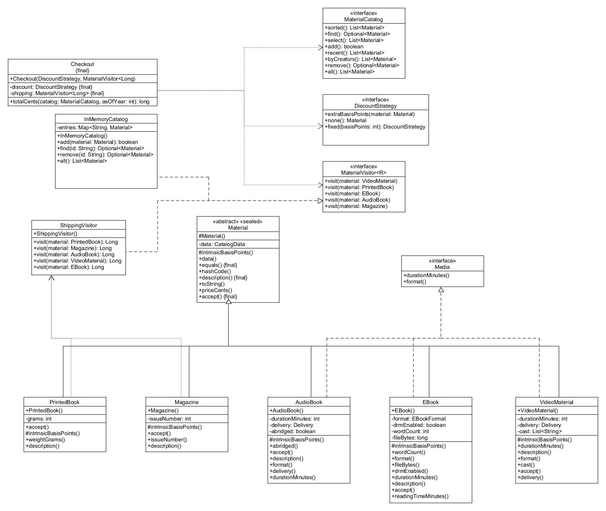

# CSSD2101-Lab2

Lab 2 Assignement related to polymorphism, abstraction, and interface.

## Design

I made a UML diagram which goes over the 5 inheritances of Material and the 3 implementations of Media, along with the policies relating to CheckOut.

Final equality prevents asymmetric subtype behavior because the final keyword for the equals and hashCode methods mean they cannot be overridden, and therefore any subclass which uses the methods cannot override its conditions (finding equality through hash codes), thus maintaining the equality.

Likewise, the reason an Ebook does not need a weightGrams field is because an EBook is digital, and does not need weightGrams. Each of the sub-classes has their own distinct attributes which works for their specific goals, which is the purpose of abstraction.

## Testing

We used JUnit 5 and Maven for testing the bookstore application.

Tests included pricing, shipping, generation of e-books, catalogue methods, and tests for bad inputs. We did boundary case testing to ensure correct calculations.

**Test results:**
- Tests: 38
- Failed: 0
- Errors: 0
- Skipped: 0

All 38 tests were successful when we ran the project on Java 25.

## Limitations

Our bookstore application is a basic one. There are no payment systems, shipping services, or persistent storage.

Our system supports only five material types that are predefined. Additional material types need modifications of the current code.

Catalogue is not designed to allow simultaneous access from multiple threads.

Despite the fact that all 38 tests were successful, it does not mean that there are no bugs in the program.
ss
